  

# 🚀 Awesome API Governance & Linting (Spectral & OpenAPI Ecosystem)

  
  
  
  
  

A curated list of awesome **API Governance**, **OpenAPI Linting**, **Spectral Rulesets**, and specification validation tools. Ensure contract consistency, prevent breaking changes, enforce OWASP security policies, and automate design style guides across your microservices and API lifecycles. 🛡️✨

---

## 📑 Table of Contents

- [📊 Sector Overview & Market Dynamics](#-sector-overview--market-dynamics)
- [💼 Commercial & SaaS Platforms](#-commercial--saas-platforms)
- [🛠️ Open-Source Linters & Governance Tools](#️-open-source-linters--governance-tools)
- [🤝 Contributing](#-contributing)
- [⭐ Star History](#-star-history)
- [💖 Support](#-support)
- [📜 License](#-license)

---

## 📊 Sector Overview & Market Dynamics

The global API management and governance market is estimated at **$6.8B – $8.8B** (2024–2025) and is projected to expand beyond **$13.5B by 2026** at a CAGR exceeding 20%, driven by enterprise microservices expansion, API-first mandates, and AI agent integration requirements. 📈

The sector exhibits a hybrid market structure: it is **concentrated at the platform layer** among enterprise cloud and gatekeeper suites (such as Google Cloud Apigee, Postman, SmartBear, and Microsoft Azure API Management), but remains **highly fragmented in the design-time governance, automated contract linting, and security policy enforcement niches**, where specialized DevSecOps vendors and vibrant open-source communities drive rapid innovation and open standards (OpenAPI, Spectral rulesets, Arazzo). 🌐

---

## 💼 Commercial & SaaS Platforms

The table below outlines commercial SaaS platforms offering automated API linting, contract security checks, and enterprise-wide API governance. Sorted by corporate valuation and scale (descending). 🏢

| Platform / Vendor | Starting Tier Price | Free Tier / Trial Limits | Company Size / Valuation & Revenue | Key Governance Capabilities |
| :--- | :--- | :--- | :--- | :--- |
| [**Snyk**](https://snyk.io/) | **$25 / dev / month** (Team plan, 5-developer minimum) | **Free forever plan**: Capped at weekly test frequency, basic open-source scanning, and limited developer access | **$7.4B valuation** (~$309M ARR / revenue) | Static code & API contract governance, integrates Optic for breaking-change prevention and Spectral rules |
| [**Postman**](https://www.postman.com/) | **$9 / user / month** (Solo plan billed annually) / **$19 / user / month** (Team) | **Free forever plan**: Strictly limited to 1 user, max 10,000 Postman API calls/month, max 5 integrations, 50 AI credits/month | **$5.6B valuation** (~$313M ARR / revenue) | Centralized API governance, automated API linting, workspace security posture, and breaking change alarms |
| [**SmartBear SwaggerHub**](https://smartbear.com/swaggerhub/) | **$19 / user / month** (Basic Team tier) | **14-day free trial** with full enterprise linting; Free Community plan capped at 1 user and limited public API definitions | **$1.8B – $2.0B valuation** (~$150M+ revenue) | Standardized API style enforcement powered by built-in Spectral rulesets, collaborative OpenAPI modeling |
| [**42Crunch**](https://42crunch.com/) | **$9 / month** (Individual plan; 1,000 tokens, 1 seat) | **Free forever tier**: Max 25 Audit and 25 Scan executions/month per repository, capped at max 3 repositories | **$17M – $25M funding** (~$2M – $5M ARR) | API contract security auditing, OpenAPI conformity, OWASP API Top 10 automated linting, CI/CD shift-left gates |
| [**Redocly**](https://redocly.com/) | **$10 / seat / month** (Pro plan, 1 project, 100 docs pages) | **7-day free trial** with full access; Free open-source CLI engine (unlimited local runs) | **Venture-backed private** (Est. seed/early-stage) | Automated OpenAPI 3.0/3.1 linting, custom style rulesets, markdown docs bundling, and enterprise developer portals |

---

## 🛠️ Open-Source Linters & Governance Tools

Curated open-source linters, CLI tools, and specification validators supporting Spectral rulesets and OpenAPI standards. Sorted by GitHub stars (descending). 🌟

| Tool | Stars | Description |
| :--- | :--- | :--- |
| [**OpenAPI Generator**](https://github.com/OpenAPITools/openapi-generator) |  | Generates client SDKs, server stubs, and API documentation, with built-in validation of OpenAPI v2, v3, and v3.1 definitions. |
| [**Fern**](https://github.com/fern-api/fern) |  | Input OpenAPI, output SDKs and docs; includes built-in spec validation, breaking change detection, and strict schema linting. |
| [**Stoplight Spectral**](https://github.com/stoplightio/spectral) |  | The industry-standard, flexible JSON/YAML linter for automated style guides, with built-in support for OpenAPI (v2, v3.0, v3.1), Arazzo, and AsyncAPI. |
| [**Swagger Client & Validator**](https://github.com/swagger-api/swagger-client) |  | JavaScript library and toolchain to connect, inspect, and validate OpenAPI and Swagger-compliant definitions. |
| [**Redocly CLI**](https://github.com/Redocly/redocly-cli) |  | High-performance CLI for OpenAPI and AsyncAPI: lint against standard or custom rulesets, bundle multi-file specs, and decorators. |
| [**Optic**](https://github.com/opticdev/optic) |  | Git-native OpenAPI linting, diffing, and contract testing. Detects breaking changes on pull requests and runs native Spectral rulesets. |
| [**vacuum**](https://github.com/daveshanley/vacuum) |  | Ultra-fast Go-based OpenAPI/AsyncAPI linter, 100% compatible with Spectral rulesets. Capable of parsing multi-megabyte specs in milliseconds. |
| [**Speccy**](https://github.com/wework/speccy) |  | Enforce quality, naming conventions, and validation rules on your OpenAPI 3.0.x specifications with human-readable output. |
| [**Swagger CLI**](https://github.com/APIDevTools/swagger-cli) |  | OpenAPI 3.0 and Swagger 2.0 command-line tool to validate and bundle schema specifications and resolve remote `$ref` pointers. |
| [**Speakeasy CLI**](https://github.com/speakeasy-api/speakeasy) |  | End-to-end OpenAPI tooling that validates, lints, and transforms API specs for automated SDK and contract generation. |
| [**OpenAPI Spec Validator**](https://github.com/python-openapi/openapi-spec-validator) |  | Python CLI and pre-commit hook that validates OpenAPI 2.0, 3.0, and 3.1 specifications against the official specification metaschemas. |
| [**Spectral OWASP Ruleset**](https://github.com/stoplightio/spectral-owasp-ruleset) |  | Official Spectral ruleset for detecting OWASP API Security Top 10 vulnerabilities directly from OpenAPI specs during CI/CD. |

---

## 🤝 Contributing

Contributions are welcome! Please read the contribution guidelines before submitting: 💡

1. Fork this repository.
2. Create a new branch: `git checkout -b feature/new-tool`.
3. Add your tool to the appropriate section maintaining sorting order:
   - **SaaS Table**: Sorted by valuation/revenue descending.
   - **Open Source Table**: Sorted by GitHub stars descending with badge link to stargazers.
4. Commit your changes and open a pull request.

---

##  Star History

---

## 💖 Support

Thank you for visiting this repository! If you found this curated collection useful for your API governance and OpenAPI linting workflows:

- ⭐ **Star** this repository to help others discover it.
- 🍴 **Fork** and contribute new tools or rulesets.
- 📢 **Share** with your developer and engineering community.
- ☕ **Buy me a coffee**: If you'd like to support continued maintenance and curation of open developer resources, consider sponsoring via the [GitHub Sponsors Dashboard](https://github.com/sponsors/ishandutta2007).

---

## 📜 License

This curated list is licensed under the [MIT License](LICENSE).
